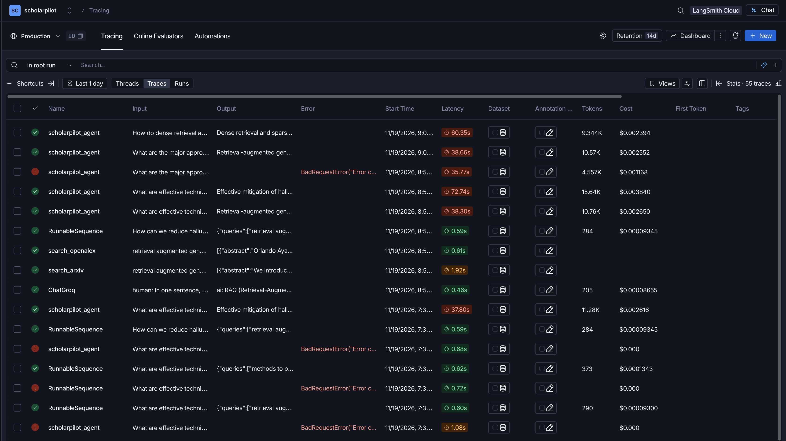
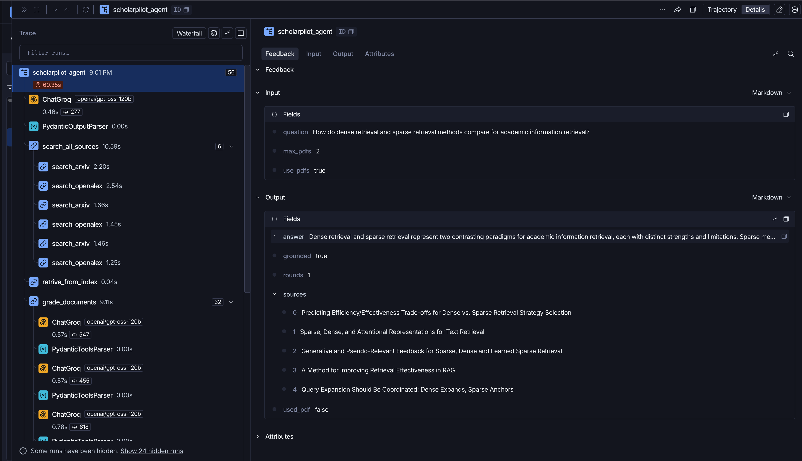

# ScholarPilot — Agentic RAG Research Assistant

ScholarPilot is an Agentic Retrieval-Augmented Generation (RAG) research assistant designed to help users discover, retrieve, evaluate, and synthesize academic research papers.

The project combines academic paper search, dense vector retrieval, LLM-based relevance grading, conditional full-text retrieval, answer generation, and grounding verification in a single research workflow.

**Current version:** V1 — Working Prototype

## Key Features

- **Query Planning:** Converts research questions into focused academic search queries using an LLM.
- **Multi-source Retrieval:** Searches academic papers from arXiv and OpenAlex.
- **Dense Retrieval:** Uses sentence embeddings and ChromaDB for semantic paper retrieval.
- **Relevance Grading:** Uses an LLM to assess whether retrieved papers are relevant to the research question.
- **Query Rewriting:** Generates alternative search queries when the initial retrieval does not find enough relevant papers.
- **Conditional PDF Retrieval:** Checks whether abstracts provide sufficient evidence and retrieves full-text PDFs when needed and available.
- **Grounded Answer Generation:** Generates literature-review-style responses using retrieved research evidence and numbered references.
- **Answer Verification:** Uses an LLM-based verifier to check whether generated claims are supported by the retrieved sources.
- **Observability:** Integrates LangSmith for tracing pipeline execution, latency, token usage, and errors.

## Architecture

```text
Research Question
       |
       v
   Query Planner
       |
       v
  Academic Search
  /             \
arXiv          OpenAlex
  \             /
       |
       v
  Deduplication
       |
       v
  ChromaDB Index
       |
       v
  Dense Retrieval
       |
       v
  LLM Relevance Grading
       |
       v
  Query Rewriting
  (if insufficient)
       |
       v
 Abstract Sufficiency Check
       |
       v
 Conditional PDF Retrieval
       |
       v
  Answer Generation
       |
       v
 Grounding Verification
       |
       v
 Research Answer + References
```

## Technology Stack

| Component | Technology |
|---|---|
| Language | Python |
| LLM Inference | Groq |
| LLM Model | OpenAI GPT-OSS 120B (via Groq) |
| Orchestration | LangChain |
| Academic Search | arXiv API, OpenAlex API |
| Embeddings | BAAI/bge-small-en-v1.5 |
| Vector Database | ChromaDB |
| PDF Processing | PyMuPDF |
| Structured Outputs | Pydantic |
| Observability | LangSmith |
| Development | Google Colab |

## LangSmith Observability

LangSmith is integrated to trace the research workflow and monitor individual components.

The following screenshots demonstrate the project's execution traces:

### Project Execution Overview



### Individual Execution Trace



## Current Limitations

This version is a working prototype and has several areas for improvement:

- Retrieval currently uses dense semantic search; hybrid BM25 and dense retrieval are planned.
- Search and retrieval quality have not yet been evaluated against a curated benchmark dataset.
- The answer verifier is LLM-based and does not guarantee perfect claim-level citation correctness.
- Full-text PDF availability and extraction quality depend on the source.
- Research reports currently provide a synthesized overview rather than a detailed paper-by-paper analysis.
- The pipeline has not yet been packaged as a production deployment.

## Planned Improvements — V2

- Hybrid retrieval using BM25 and dense embeddings.
- Reciprocal Rank Fusion (RRF) for combining retrieval results.
- Cross-encoder reranking, subject to evaluation.
- Structured research reports with paper-wise summaries, methodologies, findings, limitations, and comparative analysis.
- LangSmith evaluation datasets and experiments.
- RAGAS evaluation for faithfulness, answer relevancy, context precision, and context recall.
- Retrieval metrics such as Recall@K, Precision@K, and MRR.
- Improved citation verification and error handling.
- Performance, latency, and token-cost optimization.
- API development and containerized deployment.

## Repository Structure

```text
ScholarPilot/
├── notebooks/
│   └── Scholarpilot_RAG_v1.ipynb
├── assets/
│   ├── langsmith_project.png
│   └── langsmith_trace.png
├── README.md
├── requirements.txt
└── .gitignore
```

## Getting Started

The current implementation is developed and tested in Google Colab.

1. Clone this repository.
2. Open the notebook in Google Colab.
3. Install the dependencies listed in `requirements.txt`.
4. Configure the required API credentials using Colab Secrets.

Required secrets:

- `GROQ_API_KEY`
- `OPENALEX_API_KEY`
- `LANGSMITH_API_KEY`

LangSmith tracing configuration:

```python
os.environ["LANGSMITH_TRACING"] = "true"
os.environ["LANGSMITH_PROJECT"] = "scholarpilot"
```

Never commit API keys or private credentials.

## Project Status

**V1: Working prototype.** The current implementation successfully demonstrates academic paper discovery, dense retrieval, relevance grading, conditional evidence retrieval, answer generation, grounding verification, and LangSmith tracing.

V2 will focus on improving retrieval quality, research-report depth, systematic evaluation, and production readiness.

---

*Built as an applied project exploring Agentic AI, Retrieval-Augmented Generation, and research automation.*